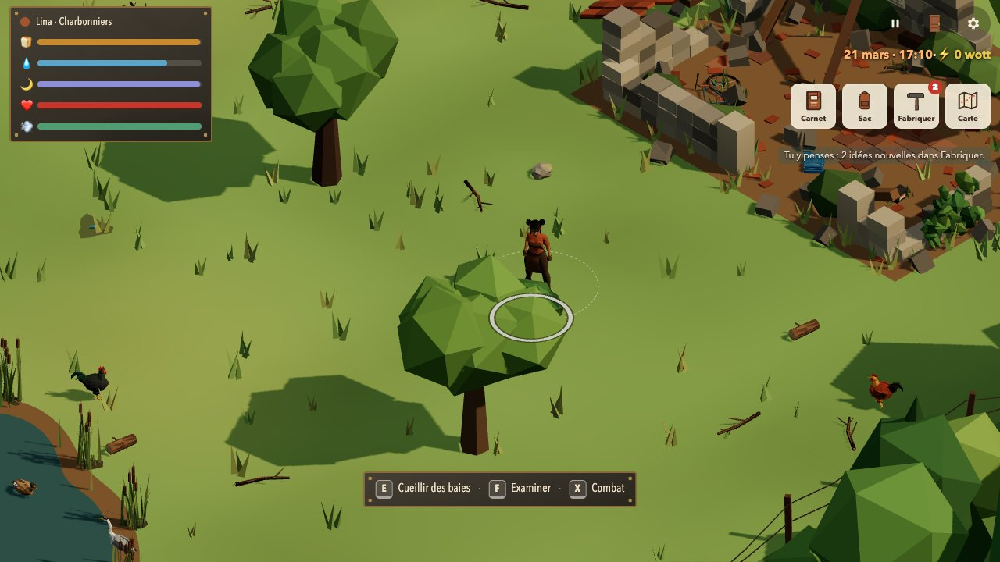
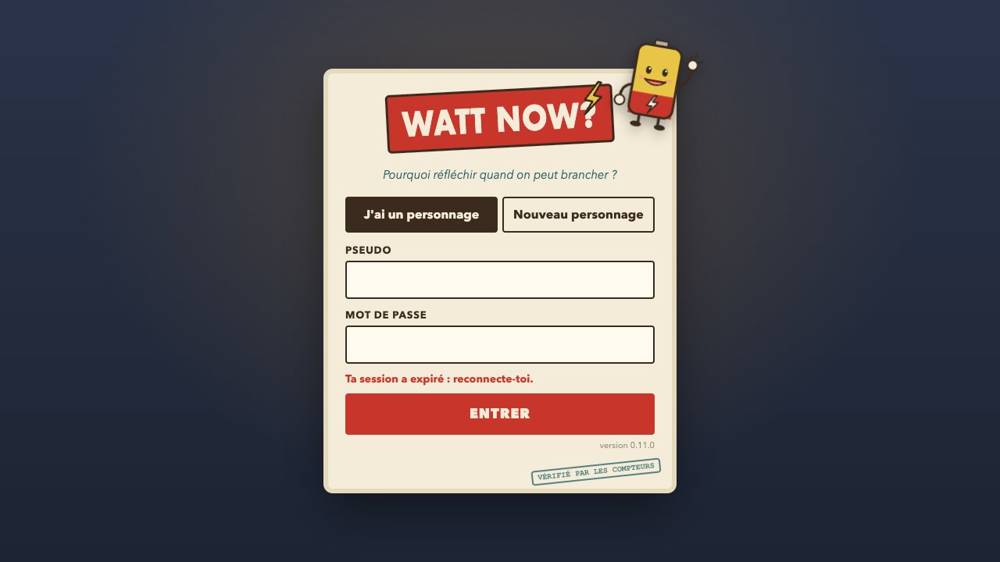
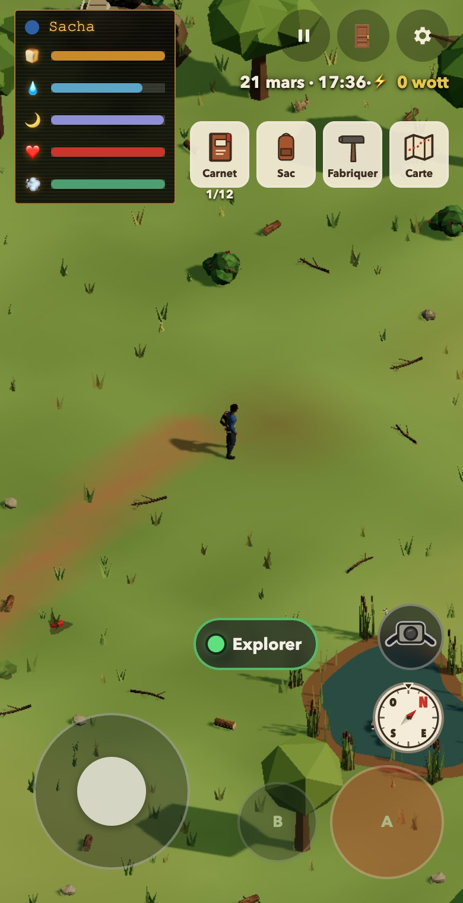

<div align="center">

# ⚡ Watt Now?

**Pourquoi réfléchir quand on peut brancher ?**

Un jeu de survie **multijoueur**, en 3D, **dans le navigateur** (ordinateur et iPhone), sans rien à installer.
Le monde ne s'est pas effondré dans un grand fracas : il s'est *abruti*, panne après panne. À toi de rallumer la lumière.

   



</div>

## Le jeu

- **Survivre** : faim, soif, sommeil, santé, souffle. Cueillir, couper, fabriquer avec ce que la nature et les ruines laissent.
- **Trois familles**, trois manières de produire l'énergie : les **Charbonniers** (le feu), les **Voltaïques** (le soleil) et les **Mécanistes** (la force des bras et des pédales).
- **Les Éteints** rôdent, et la nuit tombe vraiment. Les **haltes** sont des lieux partagés, où l'on croise d'autres voyageurs.
- **Le wott**, la monnaie du monde : on vend, on achète au **Comptoir** des Compteurs, on échange entre joueurs.
- **Le duel** (0.11) : dans les haltes, un mode Combat assumé (halo rouge), des duels courts, et le perdant laisse un objet au gagnant.
- Un tutoriel, un carnet d'objectifs et des quêtes ; tout le texte est en français.

<table>
<tr>
<td width="50%"></td>
<td width="25%"></td>
</tr>
<tr>
<td align="center"><sub>L'accueil : créer son personnage et choisir sa famille</sub></td>
<td align="center"><sub>Sur iPhone : joystick, boutons A et B, mode Explorer / Combat</sub></td>
</tr>
</table>

## Démarrer en 2 minutes

Il faut **Node.js 24 ou plus** (le serveur exécute TypeScript directement, sans compilation).

```bash
git clone https://github.com/NeustaSCV/watt-now.git
cd watt-now/code
npm ci
npm run dev
```

Puis ouvre **http://localhost:5173** et crée un personnage. Le serveur de jeu écoute sur le port 8787. La base SQLite se crée toute seule dans `code/serveur/donnees/`.

Sur un iPhone du même Wi-Fi : utilise l'adresse « sur l'iPhone » affichée au démarrage (`npm run dev:iphone` pour l'HTTPS).

## Vérifier

```bash
npm test           # ~1 360 tests (règles, serveur, client), avec le test runner de Node
npm run verif      # vérification des types TypeScript
npm run build      # le client de production, dans client/dist
npm run equilibre  # simulation de l'équilibrage
npm run rythme     # simulation du rythme d'une partie
```

## Déployer

Le jeu tient dans **une seule image Docker** : le serveur Node sert aussi le client compilé (port 8080). Les données
(base, réglages, sauvegardes quotidiennes et hebdomadaires) vivent dans le volume `/app/serveur/donnees`.

**Essai rapide en local :**

```bash
cd code
docker build -t watt-now .
docker run -p 8080:8080 -v watt-now-donnees:/app/serveur/donnees watt-now
```

**Sur un serveur**, avec les scripts de `code/deploiement/` (lancés depuis un Mac ou un Linux qui a Docker) :

```bash
cp code/deploiement/hotes.exemple.sh code/deploiement/hotes.local.sh   # puis y mettre tes adresses (fichier hors Git)
code/deploiement/deployer-prod.sh     # production : VPS derrière Traefik (HTTPS Let's Encrypt), voir prod/compose.yaml
code/deploiement/deployer.sh          # préprod : un Raspberry Pi 4 sur le réseau local
code/deploiement/admin-prod.sh        # crée le compte de la page /admin (mot de passe + code à 6 chiffres)
code/deploiement/god-prod.sh          # crée « god », le compte administrateur en jeu
```

Les scripts construisent l'image sur ta machine (`docker buildx`, pour `linux/amd64` ou `linux/arm64`), l'envoient en
SSH, puis relancent le jeu et attendent qu'il soit en bonne santé (`/api/sante`). Le guide complet, avec les sauvegardes, la remise à zéro et le retour à
une version précédente, est dans [`code/deploiement/LISEZMOI.md`](code/deploiement/LISEZMOI.md).

> **La musique** du jeu (`code/client/public/assets/musique/`) n'est pas dans ce dépôt, car elle est trop lourde. Les
> bruitages, eux, y sont.

## Sous le capot

| | |
|---|---|
| **Client** | TypeScript, [Three.js](https://threejs.org), Vite ; rendu low-poly tenu à 60 images/s sur un iPhone 13 mini |
| **Serveur** | Node.js (TypeScript natif), WebSocket (`ws`), SQLite (`node:sqlite`) ; le serveur décide de tout, le client montre |
| **Commun** | Règles, déplacement et format des messages, partagés par le client et le serveur |
| **Assets** | Personnages Quaternius et objets Kenney (CC0), sons CC0 : la liste complète est dans [`code/licences.csv`](code/licences.csv) |

## Le dépôt

| Dossier | Contenu |
|---|---|
| [`code/`](code/) | Le jeu : `client/`, `serveur/`, `commun/`, `scripts/`, `deploiement/` (voir [`code/README.md`](code/README.md)) |
| [`book/`](book/README.md) | Les **27 books de conception** : univers, familles, crafting, économie, zombies, architecture… et les plans de chaque version |
| [`son/`](son/) | Les bruitages CC0 et leurs outils |
| [`musique/`](musique/) | Le moteur de musique adaptative (les rendus ne sont pas versionnés) |
| [`intro/`](intro/), [`making-of/`](making-of/) | La cinématique d'introduction et la vidéo making-of, codées en 3D |
| [`batiment/`](batiment/) | La banque de bâtiments urbex et des haltes |
| [`outils/`](outils/) | Les outils d'aide à la conception |

L'historique des versions, de la 0.1 à la 0.11, est dans [`code/VERSIONS.md`](code/VERSIONS.md) ; chaque version porte
une étiquette Git (`v0.11`, …).

---

<div align="center"><sub>Conçu et codé en français, avec beaucoup de soin pour les petits écrans.</sub></div>
